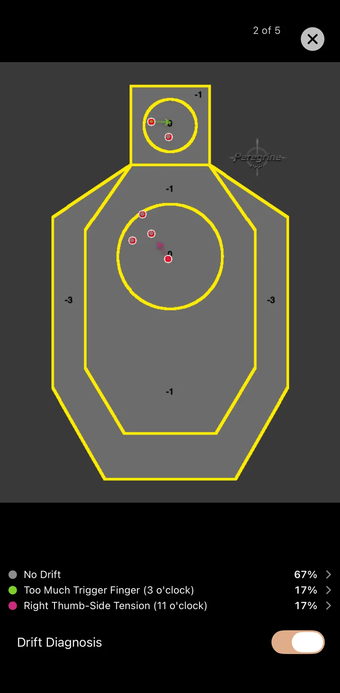
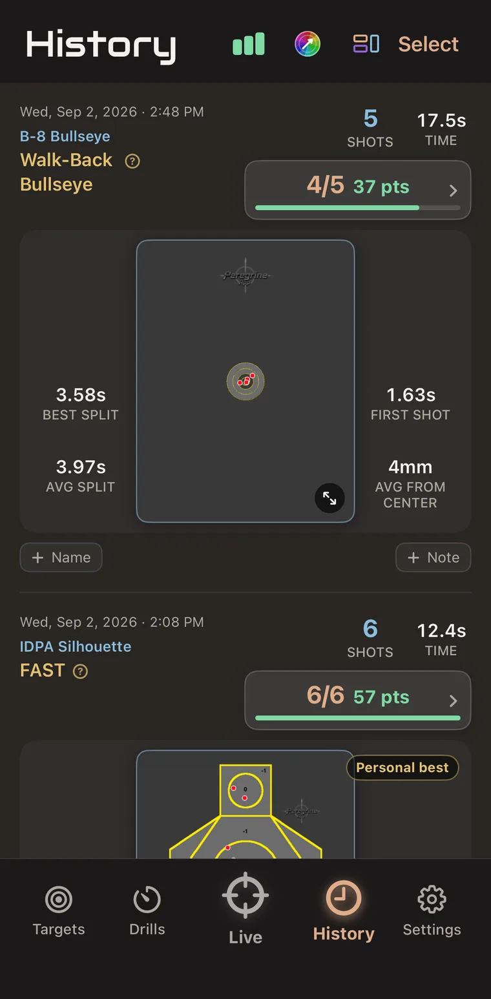

# Peregrine: Dry Fire Trainer

An iPhone and iPad app that uses the camera to detect laser training shots on printed targets and score them live. Released on the App Store in September 2026.

[App Store](https://apps.apple.com/us/app/peregrine-dry-fire-trainer/id6773954254) | [peregrinedryfire.com](https://peregrinedryfire.com)

The source code is private. This repo shows what the project is and how it was built. I'm happy to walk through the code on request.

  
  
  

## What it does

- Detects a red laser hit on a paper target at 60 frames per second and scores it live: points, points per minute, par and split times.
- Calibrates each target from printed QR codes and corner markers, so it knows the target's size, distance and scoring zones.
- Drift Diagnosis maps where the muzzle moved at each shot to 12 clock positions and prompts a correction when the same fault repeats.
- 25 built-in drills, custom drills, a par timer and session history for tracking trends.

## How I built it

I'm the sole developer. I designed the app and directed AI-assisted development with Claude Code, often with several agents working in parallel.

- Tuned the shot detector with hand-labeled shot data analyzed in SPSS. Red dominance and local contrast beat raw brightness.
- About 2,700 automated tests, TestFlight betas and on-device validation before each release.
- Published the privacy policy and terms, and ran the App Store release.

## Supporting tools (also private)

- **Website.** peregrinedryfire.com, deployed on Netlify with a scripted Git publish and regression tests.
- **Peregrine HQ.** A dashboard that pulls downloads, revenue, search and ad data once a day through GitHub Actions and the Appfigures MCP server.
- **Reddit Radar.** Finds Reddit threads about dry fire training every day and opens a GitHub issue with them. It never posts. I read every thread and reply by hand.
